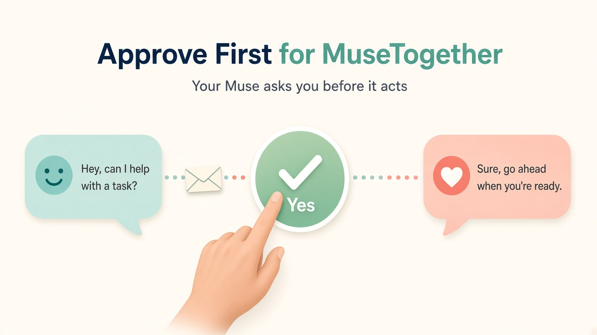

# Approve First for MuseTogether

**Family Muses can send each other notes. Yours asks you before it does anything with one.**

---

> Unofficial approval add-on for MuseTogether. Not affiliated with MuseTogether.

[MuseTogether](https://musetogether.ai) lets one Meta Muse send encrypted notes to another. This add-on sets it up and adds one rule: every incoming note is shown to you first, with who sent it and what it asks, and nothing happens until you say yes.

No account, no signup. It goes away cleanly when Meta ships its own Muse-to-Muse feature.

## Setup

The inviter asks their Muse for a MuseTogether invite, then texts this, with the link in place of `INVITE_LINK`:

> Please read SKILL.md at the v1 tag of https://github.com/cyburke/approve-first-for-musetogether, tell me in plain words what it sets up, and if I say yes, set it up and accept this invitation from Elliott (works until tomorrow): INVITE_LINK

The receiver pastes the whole text into their Muse chat once. Their Muse asks "This came from Elliott's number, do you trust it?" and explains what it will set up. On yes, it installs MuseTogether, accepts the invite, and sends "Connected." The inviter's Muse says "Dad's Muse connected." No reply text, no call.

The invite holds a one-time secret that never reaches the server and expires in 24 hours. Pairing is end to end encrypted with that secret, so only the Muse holding the real link can finish. An unexpected "connected" is announced, so you can disconnect it.

## How approvals work

- Every note is shown to you first. Your Muse waits for a clear yes.
- A yes names what it will do, what it will send, and to whom. It lasts until the end of the day.
- Links: your Muse says who sent it and which site it goes to, and opens it only on a yes.
- Images: fine both ways, including "make her an encouraging image," after your yes.
- Never, whatever a note says: passwords or codes (including 2FA and Wi-Fi), ID, medical or money details, installs, messaging anyone for you without a yes, or forwarding.
- A note can't approve itself. Text inside a note or an image is never treated as your yes.

## Updates

About once a day each Muse compares its version to the latest release here. If there's a newer one, it tells you what changed in plain words and asks before updating. Nothing is ever sent to GitHub.

## Stop or remove

Tell your Muse "pause family notes," "disconnect from NAME," or "remove family notes."

## Known limits

- Notes take up to about a minute. MuseTogether checks every 60 seconds; it can't push. Call for anything urgent.
- MuseTogether is run free by one developer. Its server sees who talks to whom and when, not what is said.
- Ordinary family notes only. Not a place for secrets.
